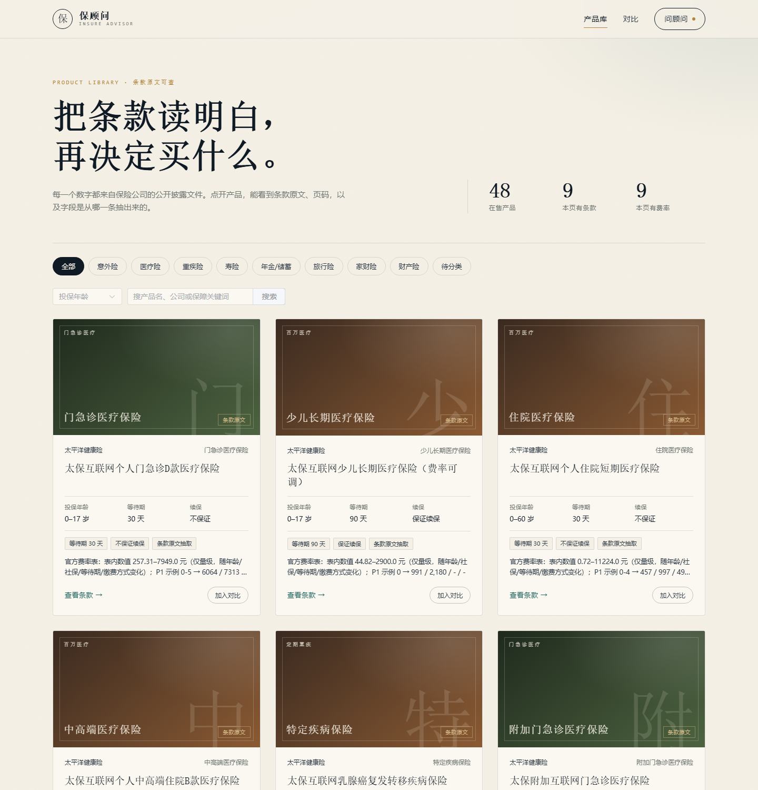
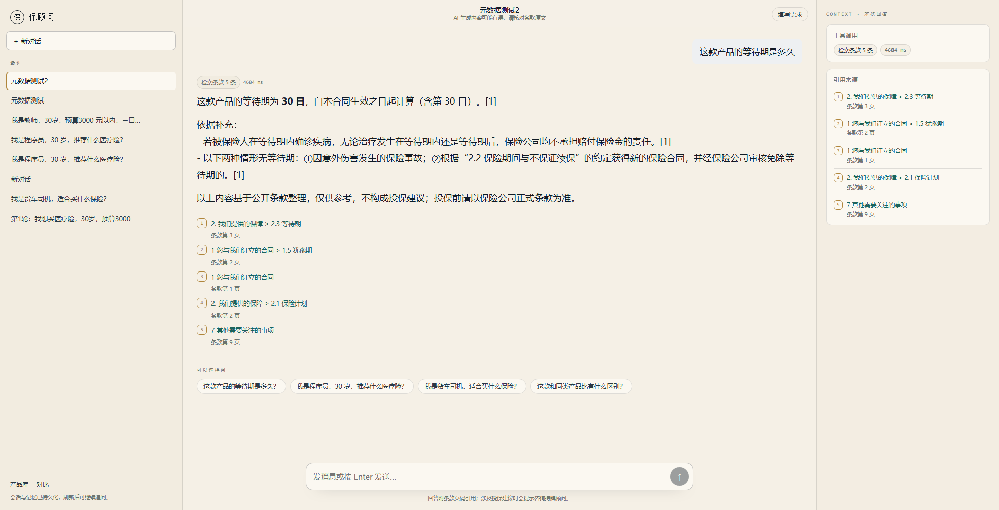

# 保顾问 · Insurance Advisor Agent

面向保险条款问答与产品推荐的智能顾问系统。**Java 业务后端 + Python AI 服务 + Vue 3 前端**，回答带条款页码引用，可回溯到原文。

> 仅用于技术研究与产品演示，不构成投保建议。产品资料来自保险公司公开披露渠道。





## 功能

- **产品库**：分类树、年龄/关键词筛选、分页、产品详情、2~4 个产品横向对比
- **条款 RAG**：MinerU 解析 PDF → 父子块切分 → Milvus 向量召回 → 父块回填；回答带 `[1][2]` 引用与页码
- **Agent 编排**：LangGraph 意图路由（条款问答 / 产品推荐 / 产品对比 / 寒暄），规则优先，失败可降级
- **工具调用**：产品筛选、产品详情、条款检索、产品对比；调用结果以摘要胶囊展示
- **多轮记忆**：每轮快照（intent / 引用 / 产品 / 职业），超过阈值后自动压缩为摘要；支持「它 / 这款」指代消解
- **职业推荐**：职业 → 险种映射（室内低风险 → 医疗 + 重疾；高风险外勤 → 意外 + 定期寿险）
- **会话管理**：新建、列表、历史消息、重命名、删除（级联清理消息 / 快照 / 摘要）
- **合规**：绝对化表述拦截 + 强制免责声明
- **工程**：SSE 真 token 流 + 前端打字机、traceId、统一响应、Swagger、Docker Compose

## 架构

```
┌─────────────────────────────┐
│ insurance-web  Vue3 + Vite  │  5173
│ 产品库 / 详情 / 对比 / 对话   │
└──────────────┬──────────────┘
               │ /api (REST)        /v1 (SSE)
┌──────────────▼──────────────┐   ┌─────────────────────────┐
│ insurance-server  Java 21   │   │ insurance-ai  Python 3.12│
│ Spring Boot 3.5             │──▶│ FastAPI + LangGraph      │
│ 分类 / 产品 / 条款 / 会话     │   │ RAG / Agent / 记忆 / 合规 │
└──────┬───────────────┬──────┘   └──────┬──────────────────┘
       │               │                  │
    MySQL 8.4       Redis 7.4         Milvus 2.5
   业务与原文块     缓存/会话          向量检索
                                        │
                                   RustFS (S3)
                                   产品图 / 对象存储
```

**两个进程不是微服务**：Java 负责事务、权限与业务规则，Python 负责重依赖的 AI 能力；通过 HTTP + SSE 协作，不引入注册中心与网关。

## 技术栈

| 层 | 选型 |
|---|---|
| 前端 | Vue 3、Vite、TypeScript、Pinia、Element Plus |
| 业务后端 | Java 21、Spring Boot 3.5、MyBatis-Plus、MySQL 8.4、Redis 7.4 |
| AI 服务 | Python 3.12、FastAPI、LangGraph、pymilvus、Ollama（bge-m3） |
| 文档解析 | MinerU 4.x（本地 flash 档） |
| 对象存储 | RustFS（S3 协议，可换阿里云 OSS / MinIO） |
| LLM | DeepSeek（OpenAI 兼容协议），可切换任意兼容服务 |
| 部署 | Docker Compose（中间件），Maven Wrapper，uv |

## 快速开始

### 0. 前置条件

- JDK 21、Node 18+、Python 3.12、uv、Docker Desktop
- DeepSeek API Key（或任意 OpenAI 兼容服务）
- 本地 embedding：Ollama + `bge-m3` 模型（`ollama pull bge-m3`）

### 1. 启动中间件

```bash
cp deploy/.env.example deploy/.env   # 修改其中的密码
docker compose -f deploy/docker-compose.yml up -d
```

包含 MySQL(3307)、Redis(6380)、etcd、RustFS(9000/9001)、Milvus(19530/9091)。

### 2. 建表

按顺序执行 `server/src/main/resources/db/migration/` 下的 `V1` ~ `V8` SQL（当前未接入 Flyway，需手动执行）。

### 3. 启动 AI 服务

```bash
cd ai
uv sync
export DEEPSEEK_API_KEY=sk-xxx        # 只从环境变量读取，不要写进文件
export MINERU_HOME=<MinerU 模型目录>   # 首次解析条款时需要
uv run uvicorn app.main:app --host 127.0.0.1 --port 8000
```

本地模型方案（不调用云端 LLM）：

```bash
export LLM_PROVIDER=ollama
export LLM_MODEL=deepseek-r1:1.5b
export LLM_BASE_URL=http://127.0.0.1:11434
```

### 4. 启动业务后端

```bash
cd server
./mvnw spring-boot:run
# 或：java -jar target/insurance-advisor-server-0.1.0-SNAPSHOT.jar
```

后端会从 `../deploy/.env` 读取数据库配置，请在 `server/` 目录下启动。

### 5. 启动前端

```bash
cd web
npm install
npm run dev
# http://127.0.0.1:5173
```

## 数据导入

仓库不分发条款 PDF（版权原因），需要自行准备公开披露文件。

```bash
cd ai

# 1) 产品与图片（源目录需包含 insurance_products.csv / clause_docs / product_images）
uv run python -m app.import.import_products --source <源目录>

# 2) 价格与费率（可选）
uv run python -m app.import.import_prices --source <源目录>

# 3) 条款解析 → 父子块 → 向量索引（可断点续跑）
uv run python -m app.ingest.batch_ingest

# 4) 单文档重建向量
uv run python -m app.rag.index_doc --doc-id <doc_id> --rebuild
```

字段抽取结果通过 `deploy/mysql/seed/02-field-extraction-updates.sql` 与 `03-field-extraction-quotes.sql` 落库。

## API 一览

| 方法 | 路径 | 说明 |
|---|---|---|
| GET | `/api/v1/categories/tree` | 分类树 |
| GET | `/api/v1/products` | 产品列表（分类 / 年龄 / 关键词 / 分页） |
| GET | `/api/v1/products/{id}` | 产品详情 + 条款列表 |
| POST | `/api/v1/products/compare` | 2~4 个产品对比 |
| GET | `/api/v1/products/{id}/images` | 产品图片（预签名 URL） |
| POST | `/api/v1/conversations` | 新建会话 |
| GET | `/api/v1/conversations` | 会话列表 |
| GET | `/api/v1/conversations/{id}/messages` | 历史消息（含引用 / 工具摘要） |
| PATCH | `/api/v1/conversations/{id}` | 重命名 |
| DELETE | `/api/v1/conversations/{id}` | 删除（级联清理） |
| POST | `/v1/chat` | AI 对话（JSON） |
| POST | `/v1/chat/stream` | AI 对话（SSE：meta / delta / final / citations） |

Swagger：`http://127.0.0.1:8080/docs`

## 目录结构

```
├── ai/                 Python AI 服务
│   ├── app/agents/     路由、提示词、LangGraph
│   ├── app/services/   检索、产品、合规、快照、摘要
│   ├── app/rag/        向量化与 Milvus
│   ├── app/ingest/     解析、归一化、切分、批量入库
│   └── app/import/     产品 / 价格导入
├── server/             Spring Boot 业务服务
│   └── src/main/resources/db/migration/  V1~V8
├── web/                Vue 3 前端
├── deploy/             docker-compose 与 .env.example
└── docs/               设计决策、计划书、截图
```

## 设计取舍

关键技术决策记录在 [docs/decisions.md](docs/decisions.md)，包括：

- D-01 为什么用 MinerU，以及它的失败模式
- D-03/D-04 解析归一化与父子块切分（含阅读顺序校正）
- D-06 向量化选型与 HNSW 代价
- D-10/D-11 产品查询与价格建模（为什么不做价格筛选）
- D-13/D-14 Agent 编排、记忆快照与真流式
- D-15/D-16 摘要压缩、设计 token 与需求表单

## 已知限制

- 14 个产品没有条款原件（直链失效或仅有营销线索），只能展示目录
- 价格口径不统一（年 / 月 / 每万元保额 / 公式），**只展示不参与筛选**
- OCR 会漏识别个别章节标题，导致少量引用路径不精确
- `/admin/**` 上传接口没有鉴权，仅适合本地开发
- 暂无自动化测试、CI 与 RAG 评测集
- 未接入第三方保险数据 MCP（OAuth 2.0 需要人工授权）

## Roadmap

- [ ] RAG 评测集（Recall@5 / MRR / 引用命中率）与消融实验
- [ ] 应用容器化与一键启动
- [ ] 单元测试与 GitHub Actions
- [ ] 第三方数据 MCP（可选能力，默认关闭）
- [ ] 条款原文引用弹层与高亮

## License

[MIT](LICENSE)

产品资料版权归各保险公司所有，本仓库仅包含代码与公开信息来源的引用，不分发条款 PDF。
